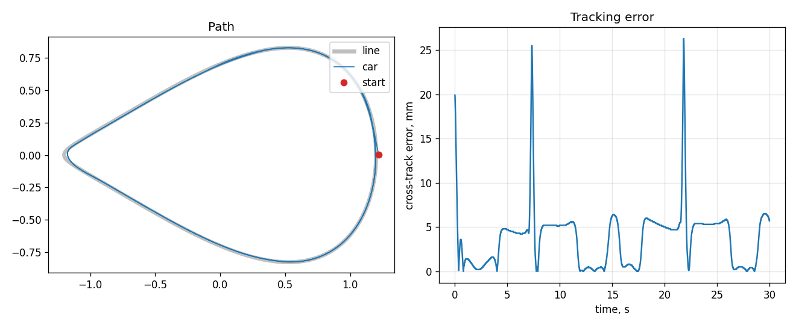

# line-follower-c

Portable C99 line-following controller for a small differential-drive car with a reflectance
sensor bar, plus a closed-loop simulator that runs the exact same controller code on a PC.



## What's inside

- **Sensor processing** (`src/line_sensor.c`): per-sensor min/max calibration of raw ADC values,
  then a sub-sensor line position from a weighted centroid around the strongest sensor. Using only
  the peak and its neighbours keeps a stray dark spot elsewhere on the floor from pulling the estimate.
- **PID** (`src/pid.c`): filtered derivative (no kick on the first sample) and conditional-integration
  anti-windup, so the integral does not explode while the motors are saturated in a sharp turn.
- **Line follower** (`src/line_follower.c`): a small state machine.
  `FOLLOW` steers with the PID and slows down in proportion to the error (i.e. in curves);
  `SEARCH` rotates toward the side where the line was last seen; `STOPPED` cuts the motors after a timeout.
  Wheel commands are scaled together so saturation keeps the turn ratio.
- **HAL** (`include/hal.h`): four functions are all a board port needs (sensor ADC scan, motor PWM, a
  microsecond clock). `examples/mcu_main.c` is the fixed-rate 100 Hz control loop built on top of it.

No heap, no globals in the library, `float` only (fits a Cortex-M4F with FPU).

## Simulator

`sim/sim.c` models a car with a 15 cm wheel base, first-order motor lag, an 8-sensor bar 8 cm ahead
of the axle, a 19 mm line with soft edges, and ADC noise. It starts 2 cm off the line and ~10° misaligned.

```
$ make test
all unit tests passed
laps: 2.06 | mean cross-track: 3.8 mm | max cross-track: 26.3 mm | PASS
```

The error spikes in the plot are the car's axle cutting the tightest corner: the sensor bar is ahead of
the axle, so the bar stays on the line while the body takes a shorter path. The sim exits non-zero if
tracking regresses, so it runs in CI next to the unit tests.

## Build

```
make test    # unit tests + simulator regression check
make plot    # writes docs/run.png (needs matplotlib)
```

## Status

Verified in simulation and unit tests. Next step: implement `hal.h` for real hardware
(e.g. PSoC 6: SAR ADC for the sensor bar, TCPWM for motor PWM) and retune gains on the car.
